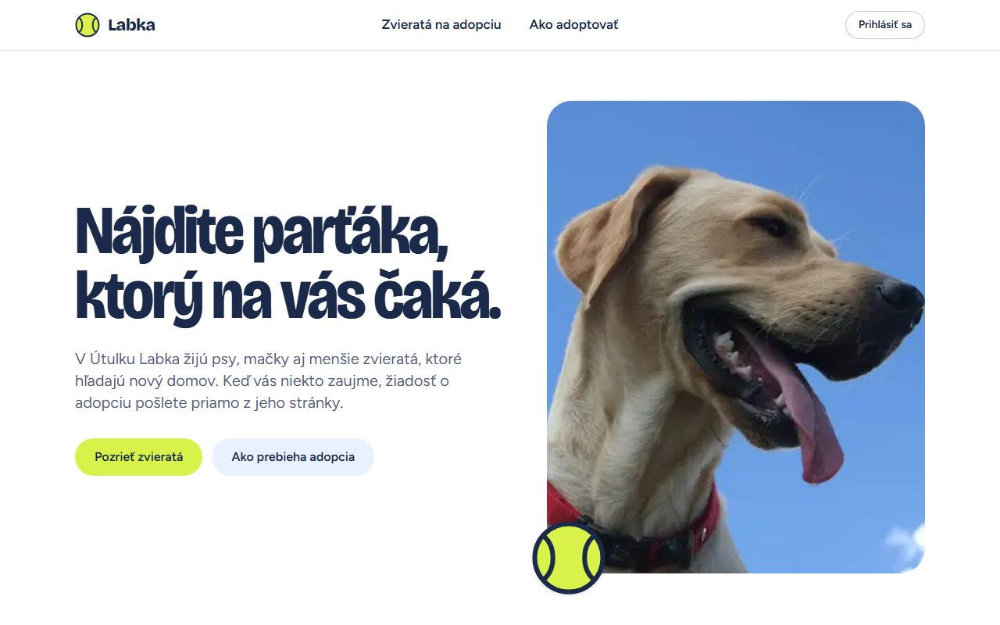
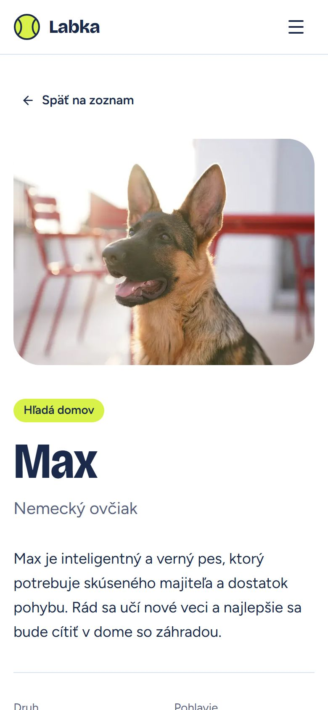
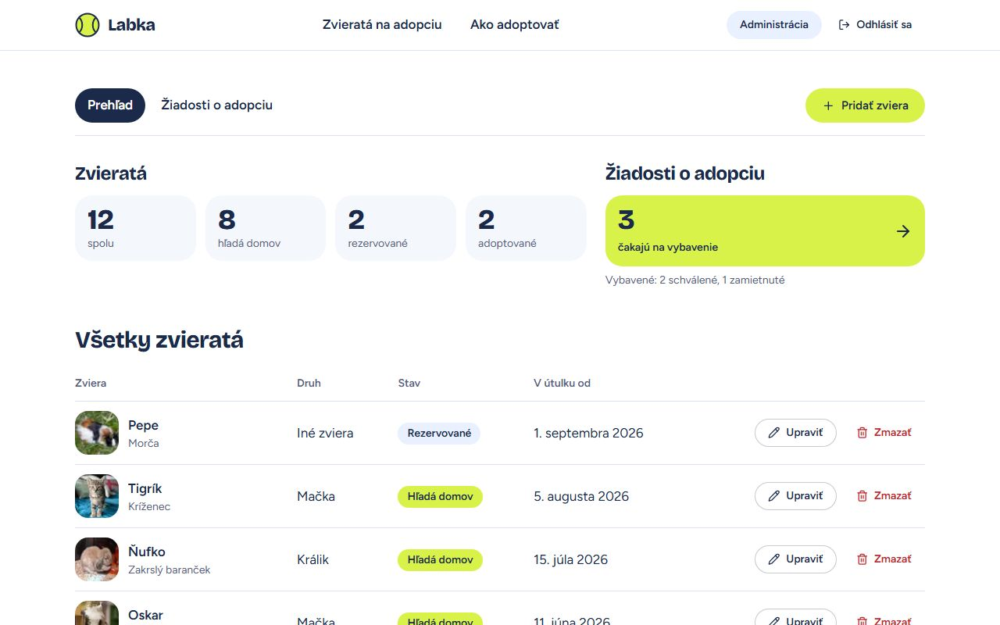
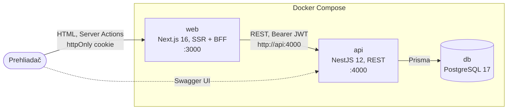
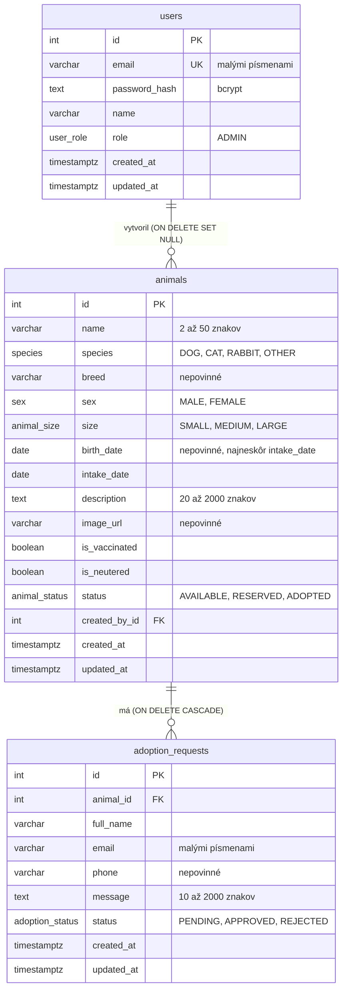

# Útulok Labka

Webová aplikácia pre útulok pre zvieratá. Návštevníci si prezerajú zvieratá na adopciu a bez registrácie pošlú žiadosť o adopciu. Správca útulku v administrácii spravuje zvieratá a vybavuje žiadosti.

Monorepo obsahuje tri časti:

- **REST API** (NestJS + PostgreSQL),
- **webovú aplikáciu** so server-side renderingom (Next.js),
- **Docker Compose** konfiguráciu, ktorá celý systém spustí jedným príkazom.

<p>
  
  &nbsp;
  
</p>

## Obsah

1. [Rýchly štart](#rýchly-štart)
2. [Funkcie](#funkcie)
3. [Splnenie zadania](#splnenie-zadania)
4. [Architektúra](#architektúra)
5. [Dátový model](#dátový-model)
6. [REST API](#rest-api)
7. [Architektonické rozhodnutia a kompromisy](#architektonické-rozhodnutia-a-kompromisy)
8. [Príručka pre vývojárov](#príručka-pre-vývojárov)
9. [Riešenie problémov](#riešenie-problémov)
10. [Čo by som pridal v produkcii](#čo-by-som-pridal-v-produkcii)
11. [Zdroje fotografií](#zdroje-fotografií)

## Rýchly štart

Stačí [Docker](https://docs.docker.com/get-docker/) s Docker Compose v2. Projekt je otestovaný s Dockerom 29 a Compose 5.

```bash
git clone <url-repozitára> utulok-labka
cd utulok-labka
docker compose up
```

Prvé spustenie trvá niekoľko minút, lebo sa zostavujú image. Potom už všetko prebehne samo:

1. Zostavia sa image API a webu. Závislosti sa inštalujú v Dockerfile cez `npm ci`.
2. Naštartuje PostgreSQL.
3. API aplikuje migrácie (`prisma migrate deploy`), naplní ukážkové dáta (`prisma db seed`) a až potom začne prijímať požiadavky.
4. Web naštartuje, až keď je API zdravé (healthchecky a `depends_on: condition: service_healthy`).

Súbor `.env` vytvárať netreba. Každá premenná má v `docker-compose.yml` vývojovú predvolenú hodnotu a prepísať sa dá podľa [`.env.example`](.env.example).

| Služba | Adresa |
|---|---|
| **Webová aplikácia** | <http://localhost:3000> |
| Administrácia | <http://localhost:3000/admin> |
| REST API | <http://localhost:4000/api> |
| Swagger UI | <http://localhost:4000/docs> |
| OpenAPI špecifikácia (JSON) | <http://localhost:4000/docs-json> |
| PostgreSQL (len z vášho počítača) | `127.0.0.1:5433` |

**Demo účet správcu:** `admin@utulok.local` / `Admin123!`

| Príkaz | Čo urobí |
|---|---|
| `docker compose up -d` | spustí všetko na pozadí |
| `docker compose logs -f api` | logy API (migrácie, seed, chyby) |
| `docker compose down` | zastaví kontajnery, dáta v databáze ostanú |
| `docker compose down -v` | zmaže aj databázu, ďalší `up` ju vytvorí a naplní nanovo |
| `docker compose up --build` | znova zostaví image po zmene kódu alebo `SITE_URL` |

## Funkcie

### Verejná časť

- **Úvod** (`/`): najnovšie zvieratá, ktoré hľadajú domov, a postup adopcie v štyroch krokoch.
- **Zoznam zvierat** (`/zvierata`):
  - vyhľadávanie v mene a plemene, ktoré ignoruje diakritiku aj veľké písmená („nufko“ nájde „Ňufko“),
  - filtre podľa druhu, veľkosti, pohlavia a stavu, zoradenie a stránkovanie,
  - všetky nastavenia sú v URL, takže prežijú obnovenie stránky, tlačidlo Späť aj zdieľanie odkazu,
  - bez JavaScriptu funguje zoznam ako bežný GET formulár, s JavaScriptom sa filtre uplatnia hneď po zmene.
- **Detail zvieraťa** (`/zvierata/2-max`): fotka, údaje a formulár žiadosti o adopciu.
  - Adresa obsahuje ID aj meno. Zastaraný alebo nesprávny slug presmeruje so stavom 308 na kanonickú adresu.
- **Prihlásenie** (`/prihlasenie`): po prihlásení sa správca vráti na stránku, ktorú chcel otvoriť.

### Administrácia

Dostupná len pre prihláseného správcu.

- **Prehľad** (`/admin`): počty zvierat a žiadostí a tabuľka všetkých zvierat (na mobile karty) s úpravou a mazaním.
- **Pridanie a úprava zvieraťa:**
  - jeden spoločný formulár,
  - fotka sa vyberá z pribalených alebo sa zadá ako URL, s náhľadom.
- **Žiadosti o adopciu** (`/admin/ziadosti`):
  - filter podľa stavu,
  - **schválenie**: zviera prejde do stavu „adoptované“ a ostatné čakajúce žiadosti o neho sa zamietnu,
  - zamietnutie a zmazanie.
- Prihlásený správca vidí v hlavičke odkaz na administráciu a odhlásenie. Na detaile zvieraťa má tlačidlo „Upraviť“.

### UX a prístupnosť

| Situácia | Riešenie |
|---|---|
| Načítavanie | Skeletony (`loading.tsx`) v zozname a v administrácii, indikátor priamo na karte pri prechode na detail, pending stav tlačidiel. Formulár je počas odosielania zablokovaný. |
| Prázdne dáta | Prázdny stav s ďalším krokom, napr. „Zrušiť filtre“ alebo „Prejsť na prvú stránku“. |
| Chyby API | Validačné chyby sa zobrazia pri konkrétnom poli (texty prichádzajú z API). Konflikty sa zobrazia ako hláška nad formulárom. Keď je API nedostupné, používateľ vidí „Služba útulku je dočasne nedostupná“ s tlačidlom „Skúsiť znova“. Keď vyprší relácia, správca sa dostane na prihlásenie s vysvetlením a po prihlásení späť. |
| Stav pri navigácii | Filtre sú v URL. „Späť na zoznam“ obnoví posledné filtre. Formulár si po chybe ponechá zadané hodnoty. Predchádzajúce stránky ostávajú vďaka React `<Activity>` pri návrate v pôvodnom stave. |
| Spätná väzba | Toasty po každej akcii a potvrdzovací dialóg pred mazaním, schválením aj zamietnutím. |
| Responzivita | Mobile-first. Overené na šírkach 375, 768, 1024 a 1440 px bez horizontálneho scrollu. Dotykové ciele majú na mobile aspoň 44 px. |
| Prístupnosť | Skip link, viditeľný focus na všetkých ovládacích prvkoch, sémantické nadpisy a landmarky, `aria-invalid` a `aria-describedby` pri chybách formulára, presun focusu na chybu alebo potvrdenie, `prefers-reduced-motion`. |

### SEO

- **Meta tagy v serverovom HTML:** `<title>`, description, canonical, Open Graph a Twitter Card sú priamo v `<head>`.
  - Detail zvieraťa má vlastný titulok, popis a `og:image` s fotkou zvieraťa.
  - Overenie: `curl -s localhost:3000/zvierata/2-max | grep -oE '<title>[^<]*|og:(title|image)" content="[^"]*'`.
- **Skutočné HTTP stavy:** neexistujúce zviera vráti 404, nekanonická adresa 308.
- **`sitemap.xml`** obsahuje aj všetky zvieratá.
- **`robots.txt`** a `noindex` vylučujú administráciu a prihlásenie.
- **Lighthouse** (mobil, verejné stránky): SEO 100, prístupnosť 100, best practices 100, výkon 81–89. Výkon je meraný pri simulovanom pomalom 4G so 4× spomaleným CPU.
  - Prihlásenie má SEO 63, lebo je zámerne `noindex`.



## Splnenie zadania

| Požiadavka | Riešenie |
|---|---|
| CRUD, HTTP metódy a stavové kódy | Zvieratá a žiadosti o adopciu cez `GET`/`POST`/`PATCH`/`DELETE`. Odpovede 200/201/204 (nové zviera s hlavičkou `Location`) a chyby 400/401/403/404/409/429/503. |
| Validácia vstupov | DTO s class-validator a globálny `ValidationPipe`. Neznáme polia vrátia 400. Pravidlá navyše strážia aj obmedzenia v databáze. |
| Jednotný formát chýb | Globálny `AllExceptionsFilter`, zdokumentovaný v Swaggeri ako `ErrorResponseDto` ([formát](#formát-chýb)). |
| OpenAPI + Swagger UI | `@nestjs/swagger` s CLI pluginom: <http://localhost:4000/docs>, JSON na `/docs-json`. |
| Autorizované endpointy | Globálny JWT guard „deny by default“, verejné endpointy sú označené `@Public()`. |
| Dátový model s väzbami a obmedzeniami | Prisma schéma a SQL migrácie: 3 tabuľky, 2 väzby 1:N, enumy, cudzie kľúče, CHECK obmedzenia a čiastočný unikátny index ([model](#dátový-model)). |
| Automatické vytvorenie štruktúry a seed | Pri štarte API beží `prisma migrate deploy && prisma db seed`. Oba kroky sú idempotentné. |
| SSR, komunikácia s API | Next.js Server Components a Server Actions volajú API zo servera. |
| Prihlásený vs. neprihlásený | httpOnly cookie s JWT. Hlavička, chránená `/admin` a tlačidlo „Upraviť“ na detaile sa líšia podľa prihlásenia. |
| Aspoň 3 stránky | 8 stránok: úvod, zoznam, detail, prihlásenie, prehľad administrácie, nové zviera, úprava zvieraťa, žiadosti. |
| Loading, prázdne stavy, chyby API | Pozri [UX a prístupnosť](#ux-a-prístupnosť). |
| Stav pri navigácii, konzistentné UX | URL parametre, `sessionStorage` pre návrat na zoznam, `<Activity>`, jednotné komponenty (shadcn/ui). |
| SEO, meta a OG v HTML zo servera | `generateMetadata` a `htmlLimitedBots`, ktoré nútia meta tagy do `<head>` ([SEO](#seo)). |
| Responzivita | Tailwind CSS mobile-first, overené na 4 šírkach. |
| Jeden príkaz `docker compose up` | Healthchecky, poradie štartu, `npm ci` v Dockerfile, predvolené hodnoty premenných. |
| Žiadne citlivé údaje v repozitári | Commitnuté sú len súbory `.env.example`. Predvolené hodnoty v compose sú zjavne vývojové (`dev-only-insecure-…`), `.env*` je v `.gitignore`. |
| README, monorepo | Tento súbor, jeden git repozitár s `apps/api` a `apps/web`. |
| **Nad rámec zadania** | 64 e2e a 23 unit testov API, TypeScript typy pre web generované z OpenAPI, ochrana proti brute-force a súbežným zmenám, audit prístupnosti. |

## Architektúra



- **Prehliadač komunikuje len s Next.js (backend-for-frontend).**
  - Stránky načítajú dáta z API na serveri. Formuláre posielajú Server Actions, ktoré volajú API.
  - JWT je uložený v httpOnly cookie, takže sa k nemu JavaScript v prehliadači nedostane. Netreba ani CORS.
- **API je jediný zdroj pravdy.** Validácia, autorizácia aj biznis pravidlá sú len v API. Web zobrazuje jeho chybové hlášky pri príslušných poliach, takže pravidlá sa nikde neduplikujú.
- **Kontrakt medzi webom a API** sú TypeScript typy generované z OpenAPI špecifikácie (`apps/web/src/lib/api/schema.d.ts`). Keď sa API zmení a web nie, typecheck zlyhá.

### Prihlásenie

1. Formulár zavolá Server Action `login`, tá pošle `POST /api/auth/login`.
2. API overí heslo (bcrypt) a vráti JWT (HS256, platnosť 8 hodín).
3. Action uloží token do cookie `labka_session` a presmeruje späť na pôvodnú stránku. Presmerovať sa dá len v rámci `/admin`, takže `?next=` nie je open redirect.
   - Vlastnosti cookie: `httpOnly`, `SameSite=Lax`, `Secure` pri https a `maxAge` rovnaký ako platnosť tokenu.
4. Každé volanie API zo servera pridá hlavičku `Authorization: Bearer`.
5. `proxy.ts` (v Next 16 nahrádza middleware) len rýchlo presmeruje návštevníka bez cookie na prihlásenie. O platnosti tokenu rozhoduje vždy API.
6. Keď API vráti 401, napríklad po vypršaní tokenu, správca sa dostane na prihlásenie s hláškou „Vaše prihlásenie vypršalo. Prihláste sa znova.“

### Štruktúra repozitára

```
.
├── apps/
│   ├── api/                      NestJS REST API
│   │   ├── prisma/               schéma, SQL migrácie, seed a ukážkové dáta
│   │   ├── src/
│   │   │   ├── main.ts           bootstrap a Swagger
│   │   │   ├── app.setup.ts      configureApp(): prefix, validácia, filter chýb, hlavičky (zdieľané s testami)
│   │   │   ├── config/           validácia premenných prostredia pri štarte
│   │   │   ├── common/           formát chýb, validácia, stránkovanie, rate limit, dátumy
│   │   │   ├── auth/             login, JWT guard, @Public()
│   │   │   ├── animals/          CRUD zvierat
│   │   │   ├── adoption-requests/
│   │   │   ├── stats/            počty pre administráciu
│   │   │   └── health/
│   │   └── test/                 e2e testy (Vitest + supertest)
│   └── web/                      Next.js aplikácia
│       ├── public/images/        fotky zvierat, OG obrázok, CREDITS.md
│       └── src/
│           ├── app/              stránky (App Router), sitemap, robots, chybové stránky
│           ├── actions/          Server Actions: prihlásenie, zvieratá, žiadosti
│           ├── components/       UI komponenty, ui/ = shadcn/ui
│           ├── lib/api/          typovaný klient API a generované typy z OpenAPI
│           └── proxy.ts          presmerovanie /admin bez prihlásenia
├── docs/screenshots/
├── docker-compose.yml
└── .env.example                  voliteľné prepísanie premenných pre compose
```

## Dátový model



**Obmedzenia v databáze.** Platia aj vtedy, keď aplikácia niečo prehliadne.

- Enumy, `NOT NULL`, dĺžky `VARCHAR`, unikátny email používateľa a cudzie kľúče so správaním `ON DELETE`.
- CHECK obmedzenia v [ručne písanej migrácii](apps/api/prisma/migrations/20261009153505_add_check_constraints/migration.sql):
  - dĺžky textov,
  - emaily uložené malými písmenami,
  - dátum narodenia najneskôr v deň príjmu.
- Čiastočný unikátny index `(animal_id, email) WHERE status = 'PENDING'`: z jedného emailu môže k zvieraťu existovať najviac jedna čakajúca žiadosť, a to aj pri súbežných požiadavkách.
- Indexy pre filtre, zoradenie a cudzie kľúče.

**Biznis pravidlá:**

- **Odoslanie žiadosti:**
  - Žiadosť sa dá poslať len na zviera v stave „hľadá domov“, inak `409 ANIMAL_NOT_AVAILABLE`.
  - Druhá čakajúca žiadosť z toho istého emailu vráti `409 DUPLICATE_ADOPTION_REQUEST`.
- **Vybavenie žiadosti:**
  - Schváliť alebo zamietnuť sa dá len čakajúca žiadosť, inak `409 ADOPTION_REQUEST_ALREADY_RESOLVED`.
  - **Schválenie** prebehne v jednej transakcii: zviera prejde na `ADOPTED`, žiadosť na `APPROVED` a ostatné čakajúce žiadosti o to isté zviera na `REJECTED`.
  - Zmeny sú podmienené `UPDATE … WHERE status = …` (optimistická súbežnosť). Keď dvaja správcovia naraz schvaľujú dve žiadosti o to isté zviera, uspeje práve jeden a druhý dostane 409.
- **Zmazanie zvieraťa** zmaže aj jeho žiadosti.
- **Dátumy bez času** (narodenie, príjem) sa ukladajú ako `DATE`. Pravidlo „nie v budúcnosti“ sa vyhodnocuje podľa dnešného dňa v časovom pásme Europe/Bratislava, nie podľa UTC.

**Seed** ([`prisma/seed.ts`](apps/api/prisma/seed.ts)):

- Pri každom štarte vytvorí alebo aktualizuje účet správcu podľa `ADMIN_EMAIL` a `ADMIN_PASSWORD`.
- 12 ukážkových zvierat a 6 žiadostí vloží len do prázdnej databázy, takže zmazané zvieratá sa po reštarte nevrátia.

## REST API

Úplnú dokumentáciu so schémami, príkladmi a chybovými odpoveďami nájdete v **Swagger UI na <http://localhost:4000/docs>**.

Postup pre chránené endpointy v Swaggeri:

1. Zavolajte `POST /api/auth/login` s demo účtom.
2. Hodnotu `accessToken` vložte cez tlačidlo **Authorize**.

| Metóda | Cesta | Prístup | Úspech | Chyby |
|---|---|---|---|---|
| `POST` | `/api/auth/login` | verejný | 200 token | 400, 401, 429 |
| `GET` | `/api/auth/me` | správca | 200 | 401, 403 |
| `GET` | `/api/animals` | verejný | 200 stránkovaný zoznam | 400 |
| `GET` | `/api/animals/{id}` | verejný | 200 | 400, 404 |
| `POST` | `/api/animals` | správca | 201 + `Location` | 400, 401, 403 |
| `PATCH` | `/api/animals/{id}` | správca | 200 | 400, 401, 403, 404 |
| `DELETE` | `/api/animals/{id}` | správca | 204 | 400, 401, 403, 404 |
| `POST` | `/api/animals/{animalId}/adoption-requests` | verejný | 201 | 400, 404, 409, 429 |
| `GET` | `/api/adoption-requests` | správca | 200 stránkovaný zoznam | 400, 401, 403 |
| `GET` | `/api/adoption-requests/{id}` | správca | 200 | 400, 401, 403, 404 |
| `PATCH` | `/api/adoption-requests/{id}` | správca | 200 | 400, 401, 403, 404, 409 |
| `DELETE` | `/api/adoption-requests/{id}` | správca | 204 | 400, 401, 403, 404 |
| `GET` | `/api/stats` | správca | 200 | 401, 403 |
| `GET` | `/api/health` | verejný | 200 / 503 (overí aj databázu) | – |

**Parametre zoznamu zvierat:**

- `species`, `sex`, `size`, `status`: filtre podľa enumov,
- `q`: hľadanie v mene a plemene bez ohľadu na diakritiku,
- `sort`: `newest`, `oldest` alebo `name`,
- `page` a `pageSize` (predvolene 12, najviac 50).

Odpoveď má tvar `{ data: [...], meta: { page, pageSize, total, totalPages } }`.

Stránkovanie je stabilné aj pri rovnakých hodnotách triediaceho kľúča, lebo pomocným kľúčom je `id`.

### Formát chýb

Každá chyba má rovnaký tvar, vrátane 404 pre neexistujúcu cestu, neplatného JSON-u a chýb databázy:

```json
{
  "statusCode": 400,
  "error": "VALIDATION_ERROR",
  "message": "Niektoré polia nie sú vyplnené správne.",
  "details": [
    { "field": "name", "message": "Meno musí mať 2 až 50 znakov." },
    { "field": "species", "message": "Vyberte druh zvieraťa." }
  ],
  "path": "/api/animals",
  "timestamp": "2026-10-09T18:27:57.735Z"
}
```

- `error` je strojovo čitateľný kód, `message` je slovenská hláška pre používateľa.
- `details` je len pri validačných chybách a obsahuje jednu hlášku na pole.
- **Doménové kódy chýb:**
  - `VALIDATION_ERROR`,
  - `INVALID_CREDENTIALS`,
  - `ANIMAL_NOT_AVAILABLE`,
  - `DUPLICATE_ADOPTION_REQUEST`,
  - `ADOPTION_REQUEST_ALREADY_RESOLVED`.
- **Ostatné chyby** majú kód podľa HTTP stavu, napríklad `NOT_FOUND`, `UNAUTHORIZED`, `TOO_MANY_REQUESTS` alebo `INTERNAL_SERVER_ERROR`.
- **Chyby Prismy** filter mapuje na zmysluplné stavy: porušenie unikátnosti na 409, chýbajúci záznam na 404 a porušenie CHECK obmedzenia na 400.
- **Pri chybe 500** ide stack trace len do logu servera, klientovi nikdy.

### Bezpečnosť

- **Autorizácia „deny by default“:** globálny guard vyžaduje platný JWT s rolou `ADMIN`. Verejné endpointy treba výslovne označiť `@Public()`, takže zabudnutý dekorátor endpoint uzamkne, nie otvorí.
- **JWT:** overuje sa algoritmus (iba HS256), vydavateľ aj platnosť. Tajomstvo musí mať aspoň 32 znakov, inak API odmietne štart.
- **Heslá:**
  - Ukladajú sa ako bcrypt s cost 12 a obmedzením na 72 bajtov.
  - Neexistujúci email aj zlé heslo vrátia rovnakú odpoveď. Pri neznámom emaile sa porovnáva s fiktívnym hashom, aby sa obe situácie nedali rozlíšiť ani podľa času odpovede.
- **Rate limit:** login a odoslanie žiadosti sú obmedzené na 5 požiadaviek za 60 sekúnd (nastaviteľné) na IP adresu. Login je navyše obmedzený aj na účet (email), takže heslo sa nedá hádať ani s podvrhnutou IP adresou (pozri [kompromisy](#architektonické-rozhodnutia-a-kompromisy)).
- **Validácia:** neznáme polia v tele požiadavky vrátia 400 (žiadny mass assignment). Hľadanie cez `$queryRaw` používa parametre a escapované vzory `LIKE`.
- **Bezpečnostné hlavičky:** API ich nastavuje cez vstavané `app.useSecurityHeaders()` z Nest 12.
- **Konfigurácia:** premenné prostredia sa validujú pri štarte, takže chybná konfigurácia zastaví kontajner hneď so zoznamom problémov.

## Architektonické rozhodnutia a kompromisy

**NestJS pre API.** Každá API požiadavka zadania má v Neste hotový, štandardný mechanizmus:

- validácia: `ValidationPipe`,
- OpenAPI zo samotných DTO: Swagger plugin,
- autorizácia: guardy,
- jednotné chyby: exception filter.

Modulárna štruktúra a dependency injection uľahčujú testovanie. Alternatívou bolo Express alebo Fastify s ručne poskladanými knižnicami: menej abstrakcie, ale viac vlastného „lepidla“.

**Next.js ako BFF namiesto SPA, ktorá volá API priamo.**

- SSR a meta tagy v HTML zo servera sú požiadavka zadania a App Router ich dáva priamo.
- Token v httpOnly cookie je bezpečnejší ako token v `localStorage`, lebo ho XSS neukradne, a netreba riešiť CORS.
- **Cena:** každá požiadavka ide cez server Next.js, teda jeden sieťový skok navyše.

**Prisma a ručne písané SQL v migráciách.**

- Deklaratívna schéma a typovaný klient pokryjú 95 % potrieb.
- Čo Prisma nevie vyjadriť (CHECK obmedzenia, čiastočný unikátny index, rozšírenie `unaccent`), je vo verzovaných SQL migráciách.
- Jediný raw SQL dotaz je vyhľadávanie bez diakritiky.

**Migrácie a seed pri štarte kontajnera API.** Takto zadanie dosiahne „jeden príkaz“ a oba kroky sú idempotentné.

- **Cena 1:** API image obsahuje Prisma CLI a `tsx`, preto má približne 840 MB.
- **Cena 2:** pri viacerých replikách by migrácie spúšťala každá z nich.
- V produkcii by migrácie bežali ako samostatný jednorazový job pred nasadením.

**Dve nezávislé aplikácie bez npm workspaces.**

- Každá má vlastný `package.json`, lockfile a Dockerfile, takže Docker build kontext je jednoduchý a aplikácie sa dajú nasadzovať oddelene.
- Zdieľaný je len kontrakt, teda typy generované z OpenAPI. `schema.d.ts` je commitnutý, aby build webu nepotreboval bežiace API.
- **Cena:** po zmene API treba spustiť `npm run gen:api`. Zabudnutie odhalí typecheck.

**Validácia len v API.** Formuláre majú `noValidate` a zobrazujú hlášky z API.

- Pravidlá sú na jednom mieste a hlášky sú vždy konzistentné.
- **Cena:** každá kontrola vyžaduje jednu požiadavku na server, čo je pri tejto veľkosti formulárov zanedbateľné.

**Bezstavový JWT bez refresh tokenu.**

- Jednoduchý a stačí pre jedného správcu.
- **Cena:** token sa nedá odvolať pred vypršaním. Odhlásenie len zmaže cookie.

**Next.js 16 Cache Components (PPR).**

- Statický shell stránky sa vyrenderuje pri builde a dáta prúdia v `Suspense`, takže stránka sa začne vykresľovať okamžite.
- `<Activity>` drží predchádzajúce stránky skryté, takže návrat späť obnoví ich stav.
- **Detail zvieraťa je vedome blokujúci** (`instant = false`). Pri streamingu je stav 200 odoslaný skôr, než sa zistí, že zviera neexistuje. Blokujúci render vráti skutočnú 404 a 308.
  - **Cena:** detail nemá skeleton. Nahrádza ho indikátor na kliknutej karte.

**`htmlLimitedBots: /.*/`.** Next.js bežným prehliadačom streamuje metadáta až do `<body>`. Zadanie však vyžaduje meta tagy v HTML zo servera, takže sú v `<head>` pre každého klienta.

- **Cena:** prvý bajt odpovede čaká na `generateMetadata`.

**Žiadna cache dát (`use cache`).**

- Zmena v administrácii musí byť na webe viditeľná okamžite. API navyše počas buildu nebeží.
- Dotazy sú jednoduché a pokryté indexmi.
- V produkcii by som pridal `cacheTag` a `revalidateTag` po každej zmene.

**Fotky pribalené v repozitári a pole URL namiesto uploadu.**

- Upload by vyžadoval úložisko, validáciu súborov a ich čistenie, čo je nad rámec zadania.
- Správca vyberie pribalenú fotku alebo zadá ľubovoľnú URL. Externé URL sa zobrazujú bez optimalizácie, aby fungoval akýkoľvek hosting.

**Rate limit a IP klienta.** API počíta limit podľa IP z `X-Forwarded-For`, ktorú mu posiela web. Dôveruje jej len z privátnych sietí (`TRUST_PROXY`), teda od kontajnera `web`.

- V tomto lokálnom setupe nie je pred webom reverse proxy, ktorá by hlavičku prepísala. Klient si ju preto môže podvrhnúť, rovnako ako pri priamom volaní API na porte 4000.
- **Login je preto obmedzený aj na účet**, čo podvrhnutá IP neobíde (overuje to e2e test).
- **Cena:** útočník môže zablokovať prihlásenie konkrétneho účtu, ale nanajvýš na dĺžku okna (60 s), kým útok trvá.
- Spam verejných žiadostí s podvrhnutými IP adresami v tomto setupe zastavený nie je. V produkcii hlavičku prepisuje reverse proxy alebo load balancer a limity sú v Redise, zdieľané medzi inštanciami (teraz sú v pamäti).

**Nedostupné API.** Stránka sa vykreslí s hláškou a tlačidlom „Skúsiť znova“, ale HTTP stav je 200, lebo chyba nastane až v streamovanej časti.

## Príručka pre vývojárov

Potrebujete Node.js 24, npm a Docker (na databázu).

### Lokálny vývoj bez Dockeru

API a web bežia priamo na vašom počítači s hot reloadom, databáza v Dockeri. Ak bežia kontajnery `api` a `web`, najprv ich zastavte, aby sa uvoľnili porty: `docker compose stop api web`.

```bash
# 1. Databáza (port 5433)
docker compose up -d db

# 2. API na http://localhost:4000
cd apps/api
cp .env.example .env
npm ci
npm run db:deploy        # aplikuje migrácie
npm run db:seed          # správca a ukážkové dáta
npm run start:dev        # watch mode

# 3. Web na http://localhost:3000 (v druhom termináli)
cd apps/web
cp .env.example .env.local
npm ci
npm run dev
```

Ak meníte len frontend, stačí API z Dockeru: `docker compose up -d db api` a potom krok 3.

### Zmena databázovej schémy

1. Upravte `apps/api/prisma/schema.prisma`.
2. Spustite `npm run db:migrate -- --name popis_zmeny`. Vytvorí sa migrácia, aplikuje sa a pregeneruje sa Prisma klient.
3. Pre SQL, ktoré Prisma nevie vyjadriť (CHECK, čiastočné indexy):
   1. `npx prisma migrate dev --create-only --name popis_zmeny`,
   2. doplňte SQL do vygenerovaného súboru,
   3. spustite `npm run db:migrate`.
4. Priečinok migrácie commitnite. Kontajner API ju aplikuje pri ďalšom štarte.

Databázu si môžete prezrieť cez `npm run db:studio` (Prisma Studio).

### Zmena API kontraktu

Po zmene DTO alebo controllera vygenerujte typy pre web. API musí bežať na porte 4000:

```bash
cd apps/web
npm run gen:api          # prepíše src/lib/api/schema.d.ts z /docs-json
npm run typecheck        # ukáže miesta, ktoré treba upraviť
```

### Testy

```bash
docker compose up -d db
cd apps/api
npm test                 # 23 unit testov (validátory, skladanie validačných chýb)
npm run test:e2e         # 64 e2e testov proti skutočnej PostgreSQL
```

**Nastavenie e2e testov:**

- Bežia proti samostatnej databáze `shelter_test` v tom istom kontajneri. Databázu vytvorí a zmigruje `globalSetup`.
- Adresu databázy berú z `TEST_DATABASE_URL`, nikdy z `DATABASE_URL`. Databázu, ktorej názov neobsahuje „test“, odmietnu použiť, takže omylom nezmažú vývojové dáta.
- Aplikáciu skladajú tou istou funkciou `configureApp()` ako produkcia. Testuje sa teda presne tá istá konfigurácia (prefix, validácia, filter chýb, hlavičky).
- Každý test si pripraví vlastné dáta a nezávisí od seedu ani od poradia.

**Čo e2e testy pokrývajú:**

- stavové kódy a formát chýb,
- validáciu vrátane hraničných hodnôt,
- autorizáciu (bez tokenu, token podpísaný iným kľúčom, nepodpísaný token s `alg: none`, token zmazaného účtu),
- biznis pravidlá žiadostí,
- súbežné schválenie,
- stránkovanie, filtre a vyhľadávanie bez diakritiky vrátane escapovania `%`,
- rate limit na IP aj na účet.

### Kvalita kódu

| Aplikácia | Príkazy |
|---|---|
| `apps/api` | `npm run lint` (oxlint), `npm run format` (Prettier), `npm run build` |
| `apps/web` | `npm run lint` (ESLint), `npm run typecheck`, `npm run format` (Prettier), `npm run build` |

### Premenné prostredia

Pre Docker Compose sú všetky voliteľné. Prepisujú sa v koreňovom `.env` (vzor: [`.env.example`](.env.example)). Pri lokálnom vývoji ich čítajú `apps/api/.env` a `apps/web/.env.local` (vzory v [`apps/api/.env.example`](apps/api/.env.example) a [`apps/web/.env.example`](apps/web/.env.example)).

| Premenná | Predvolená hodnota | Popis |
|---|---|---|
| `POSTGRES_USER`, `POSTGRES_PASSWORD`, `POSTGRES_DB` | `shelter`, `shelter_dev_password`, `shelter` | Prístup k databáze. Platia len pri prvom vytvorení databázy. |
| `POSTGRES_HOST_PORT` | `5433` | Port databázy na vašom počítači (len `127.0.0.1`). |
| `API_HOST_PORT` | `4000` | Port API a Swagger UI. |
| `JWT_SECRET` | `dev-only-insecure-…` | Kľúč na podpis tokenov, aspoň 32 znakov. |
| `JWT_EXPIRES_IN_SECONDS` | `28800` | Platnosť prihlásenia (8 hodín). |
| `ADMIN_EMAIL`, `ADMIN_PASSWORD`, `ADMIN_NAME` | `admin@utulok.local`, `Admin123!`, `Správca útulku` | Účet správcu, ktorý seed vytvorí alebo aktualizuje pri každom štarte. Heslo má aspoň 8 znakov a najviac 72 bajtov. |
| `RATE_LIMIT_MAX_REQUESTS`, `RATE_LIMIT_WINDOW_SECONDS` | `5`, `60` | Limit pre login a odoslanie žiadosti. |
| `WEB_HOST_PORT` | `3000` | Port webu. |
| `SITE_URL` | `http://localhost:3000` | Verejná adresa webu pre canonical a Open Graph URL. Zapisuje sa aj pri builde, takže po zmene treba `docker compose up --build`. |
| `PUBLIC_API_DOCS_URL` | `http://localhost:4000/docs` | Odkaz na Swagger UI v pätičke webu (tiež build argument). |

Vnútorné premenné nastavuje compose sám: `DATABASE_URL`, `API_INTERNAL_URL=http://api:4000`, `NODE_ENV` a `PORT`. API navyše pozná `TRUST_PROXY` (predvolene `loopback, linklocal, uniquelocal`), teda od ktorých adries prijme `X-Forwarded-For`.

## Riešenie problémov

| Problém | Riešenie |
|---|---|
| Port 3000, 4000 alebo 5433 je obsadený | V koreňovom `.env` nastavte `WEB_HOST_PORT`, `API_HOST_PORT` alebo `POSTGRES_HOST_PORT`. |
| Chcem začať s čistými dátami | `docker compose down -v && docker compose up` |
| Po zmene `POSTGRES_PASSWORD` sa API nevie pripojiť | PostgreSQL nastaví heslo len pri prvom vytvorení dát. Spustite `docker compose down -v`. |
| Po zmene `SITE_URL` sa nič nezmenilo | Hodnota sa zapisuje pri builde: `docker compose up --build`. |
| Zmenil som `ADMIN_PASSWORD` | Seed účet aktualizuje pri štarte API: `docker compose restart api`. |
| Kontajner `api` sa nespustí | `docker compose logs api`. Pri chybnej konfigurácii API vypíše zoznam problémov s premennými. |
| Prihlásenie hlási „Príliš veľa požiadaviek“ | Po 5 pokusoch za minútu treba počkať 60 sekúnd. |
| Lokálne API hlási `P1001 Can't reach database` (Windows) | V `DATABASE_URL` použite `127.0.0.1` namiesto `localhost`. |
| Web hlási „Služba útulku je dočasne nedostupná“ | API nebeží alebo štartuje: `docker compose ps` a `docker compose logs api`. |

## Čo by som pridal v produkcii

- **Nasadenie:**
  - migrácie ako samostatný jednorazový job,
  - menší runtime image API bez Prisma CLI,
  - CI pipeline (lint, typecheck, unit a e2e testy, build image, kontrola aktuálnosti `schema.d.ts`),
  - Playwright testy webu a Lighthouse CI.
- **Bezpečnosť:**
  - tajomstvá zo secret managera,
  - HTTPS s HSTS a Content Security Policy pre web,
  - API dostupné len v privátnej sieti, reverse proxy, ktorá prepisuje `X-Forwarded-For`,
  - rate limit v Redise,
  - CAPTCHA na verejnom formulári.
- **Účty:**
  - krátko platný access token s refresh tokenom (alebo serverové relácie) s možnosťou odvolania,
  - správa používateľov a rolí, reset hesla, audit log zmien.
- **Fotky:** upload do object storage (S3 alebo MinIO) s kontrolou typu a veľkosti a generovaním náhľadov.
- **Notifikácie:** email žiadateľovi po odoslaní a vybavení žiadosti a správcovi pri novej žiadosti.
- **Observability:**
  - štruktúrované logy s request ID cez web aj API,
  - metriky a tracing (OpenTelemetry),
  - error tracking (napríklad Sentry).
- **Výkon:**
  - cache verejných dát s invalidáciou po zmene v administrácii,
  - CDN pre obrázky,
  - menšia podmnožina písma.

## Zdroje fotografií

Fotografie zvierat pochádzajú z Wikimedia Commons a sú použité podľa licencií Creative Commons. Autori a licencie sú v [`apps/web/public/images/animals/CREDITS.md`](apps/web/public/images/animals/CREDITS.md) a na webe cez odkaz „Autori fotografií“ v pätičke. Mená zvierat, popisy a žiadosti sú vymyslené.
